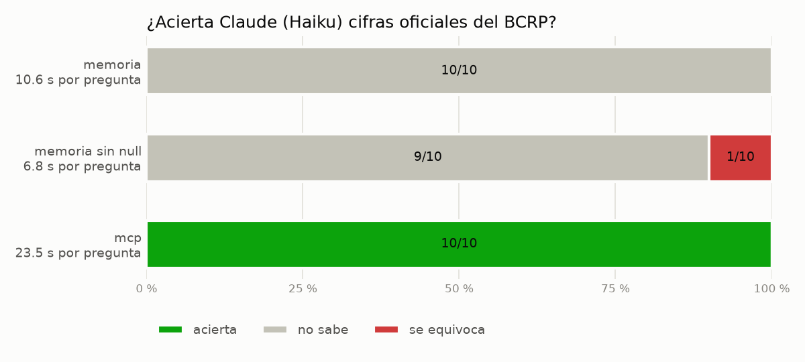

# Informe · ¿Le sirve a Claude un MCP con las series del BCRP?

## 1. Qué construí

Un servidor MCP en Python con FastMCP 4 ([server.py](server.py)) sobre la API pública del BCRP:

| Primitiva | Nombre | Qué hace |
|---|---|---|
| Herramienta | `buscar_series` | Busca el código entre las 17,167 series del catálogo |
| Herramienta | `serie` | Baja los datos entre dos fechas (mensual, diaria, trimestral o anual) y devuelve la URL de la fuente |
| Herramienta | `resumen` | Primero, último, cambio, variación %, promedio, máximo y mínimo, calculados en Python |
| Herramienta (propia) | `comparar_paises` | Compara al Perú con otros países con un indicador anual del Banco Mundial; devuelve datos, promedio, ranking y la URL |
| Recurso (plantilla) | `bcrp://serie/{codigo}` | Ficha de una serie: nombre, frecuencia, inicio, actualización |
| Recurso | `bcrp://series-clave` | Los códigos más consultados |
| Prompt | `informe(tema)` | Cinco viñetas, cada una con código de serie, periodo y fuente |

**Por qué `comparar_paises`:** el BCRP publica solo cifras del Perú, así que preguntas como «¿creció el Perú más que
Chile?» quedaban fuera. La herramienta usa la API del Banco Mundial (sin clave), valida los códigos antes de llamar y
devuelve la URL consultada, igual que `serie`. Ejemplo (crecimiento del PBI real, 2023–2025): Perú −0.35 %, 3.52 % y
3.43 % (promedio 2.20 %), por encima de Chile (1.98 %) y Colombia (1.66 %).

**Pruebas:** `uv run pytest -q` → **8 passed** (32 s, con datos reales del BCRP).

## 2. Evaluación

10 preguntas en [preguntas.csv](preguntas.csv): las 8 del curso y 2 mías, con la verdad sacada de la web del BCRP:

| id | Pregunta | Verdad | Serie |
|---|---|---|---|
| `export_ago26` | Exportaciones FOB de agosto de 2026, millones de US$ | 10,815.4 | PN38714BM |
| `desempleo_set26` | Tasa de desempleo de Lima Metropolitana (promedio móvil 3 meses), setiembre de 2026, % | 4.37 | PN38063GM |

Se corrió con `uv run evaluar.py` (Haiku, `claude -p`, 20 llamadas) → [resultados.csv](resultados.csv).

| Modo | Acierta | Se equivoca | No sabe | Segundos promedio |
|---|---|---|---|---|
| memoria | 0 | 0 | 10 | 10.6 |
| mcp | **10** | 0 | 0 | 23.5 |
| memoria sin null *(experimento)* | 0 | **1** | 9 | 6.8 |



### Qué acertó, qué falló y por qué

- **memoria (0/10):** Haiku no tiene herramientas ni cifras de 2026 (su conocimiento llega a mediados de 2026), y como la
  instrucción le permitía responder `null`, dijo que no sabía en las 10. Incluso en las de 2025 prefirió no estimar.
  En `fuente` escribió cosas como «No tengo acceso a internet ni a fuentes oficiales en esta sesión».
- **mcp (10/10):** acertó todas, incluidas mis dos preguntas (exportaciones 10,815.40; desempleo 4.37). En cada una usó
  entre 4 y 6 turnos: primero `buscar_series` para encontrar el código y luego `resumen` o `serie`, sin calcular a mano.
  Cada `fuente` trae el código de la serie, el periodo y la URL de la API del BCRP, así que se puede verificar.
- **El costo es el tiempo:** 23.5 s por pregunta contra 10.6 s de memoria, por esos turnos extra y porque cada `claude -p`
  arranca el servidor de nuevo.

### Experimento extra: sin salida fácil

Corrí `uv run evaluar.py --modos memoria --sin-null --salida resultados_sin_null.csv`, que quita de la instrucción la
frase «Si no puedes saberlo con certeza, pon valor null: no estimes.» → [resultados_sin_null.csv](resultados_sin_null.csv).

Haiku siguió diciendo que no sabía en 9 de 10, pero en una **inventó una cifra**: para la variación mensual del IPC de
Lima en marzo de 2025 respondió **0.19 %**, cuando la oficial es **0.81 %**, y la presentó como «cifra de memoria […]
reportada por el INEI». Es el peligro de fondo: un número con apariencia de dato oficial y sin forma de rastrearlo. Con
el MCP la misma pregunta devolvió 0.81 % y la URL de la serie PN01271PM.

## 3. Dos cifras comprobadas a mano en la web del BCRP

| Cifra | Lo que devolvió el MCP | Lo que muestra la web del BCRP | Tabla |
|---|---|---|---|
| Inflación Lima 12 meses, set-2026 (PN01273PM) | 4.55 % | 4.55 % | [ver tabla](https://estadisticas.bcrp.gob.pe/estadisticas/series/mensuales/resultados/PN01273PM/html/2026-1/2026-9/) |
| Exportaciones FOB, ago-2026 (PN38714BM) | 10,815.40 millones de US$ | 10,815 millones de US$ | [ver tabla](https://estadisticas.bcrp.gob.pe/estadisticas/series/mensuales/resultados/PN38714BM/html/2026-1/2026-9/) |

La tasa de desempleo de setiembre de 2026 se ve en
[esta tabla](https://estadisticas.bcrp.gob.pe/estadisticas/series/mensuales/resultados/PN38063GM/html/2026-1/2026-9/)
(4.4 %, redondeado a un decimal; el MCP dio 4.37).

## 4. Conclusión

Un MCP vale la pena cuando las preguntas se repiten sobre una fuente oficial con API estable y cada cifra tiene que
poder verificarse: aquí pasó de 0 a 10 aciertos, con el código y la URL en cada respuesta. Sin él, el modelo o dice que
no sabe o, si se le quita esa salida, puede inventar un número creíble. La búsqueda web basta para preguntas sueltas o
sobre fuentes sin API, aunque depende de encontrar la página correcta y no deja una fuente tan precisa. El precio del
MCP es construirlo y mantenerlo, y unos segundos más por pregunta.

## Cómo reproducirlo

Los notebooks recorren todo con sus resultados: [01_servidor_mcp.ipynb](01_servidor_mcp.ipynb) (el servidor parte por
parte y las 8 pruebas) y [02_evaluacion.ipynb](02_evaluacion.ipynb) (evaluación, experimento, gráfico y análisis).
Desde la terminal:

```bash
uv run pytest -q
uv run evaluar.py
uv run evaluar.py --modos memoria --sin-null --salida resultados_sin_null.csv
uv run graficar.py resultados.csv resultados_sin_null.csv
```

Cambios a `evaluar.py` respecto del original: las opciones `--sin-null` y `--salida` para el experimento, y
`encoding="utf-8"` al leer la salida de `claude -p`, que en Windows fallaba con las tildes. `test_server.py` no se tocó.
