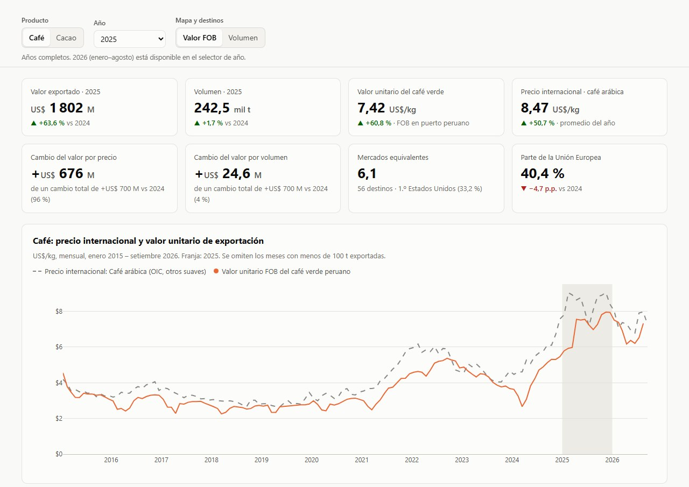
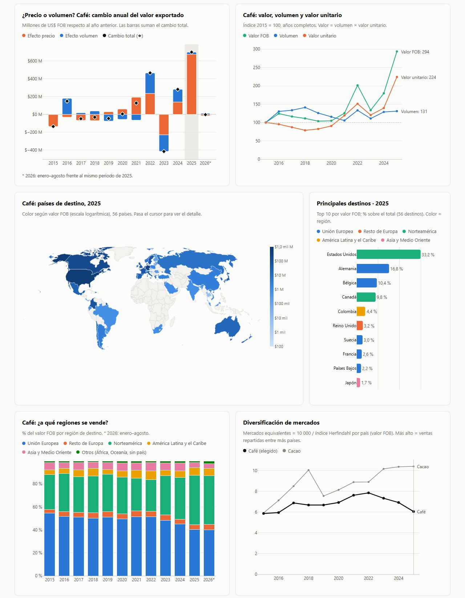
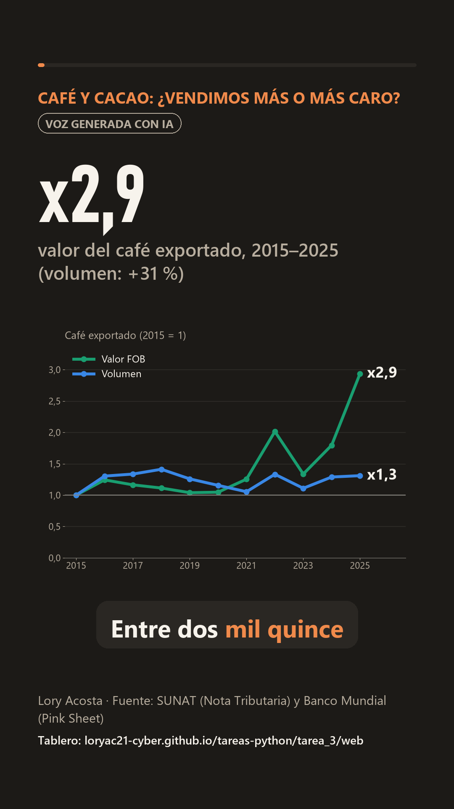

# Tarea 3 · Precios internacionales y desempeño de las exportaciones peruanas de café y cacao, 2015–2025

**Dashboard público:** <https://loryac21-cyber.github.io/tareas-python/tarea_3/web/>
**Publicación de LinkedIn:** _(pendiente)_



## 1. Tema y pregunta de investigación

El café y el cacao están entre las principales exportaciones agrarias del Perú y sostienen a miles de familias productoras de la selva
central y la Amazonía. Entre 2021 y 2025 sus precios internacionales llegaron a los niveles nominales más altos desde 1960, y el valor
exportado batió récords. Este proyecto separa cuánto de ese crecimiento fue **precio** y cuánto **volumen**, y propone un **seguimiento de la
diversificación de mercados** (Unión Europea y otros continentes).

> **Pregunta:** ¿cuánto del crecimiento del valor exportado de café y cacao entre 2015 y 2025 se explica por los precios internacionales y
> cuánto por el volumen, y qué tan diversificados están sus mercados de destino?

**Indicadores de seguimiento:** efecto precio y efecto volumen, valor unitario frente al precio internacional, participación por región de
destino y *mercados equivalentes* (10 000 / índice Herfindahl-Hirschman).

**Cobertura:** Perú → todos los países de destino, agrupados en 7 regiones. Enero 2015 a diciembre 2025 (años completos) y enero–agosto
2026 como dato reciente. Datos mensuales.

## 2. Descripción del proyecto

1. Se descargan los cuadros oficiales de exportación de SUNAT (café: partida 0901; cacao: 1801–1806) y los precios internacionales del
   Banco Mundial.
2. Se normalizan los países de destino (ISO-3 y región) y se clasifica cada subpartida por tipo de producto (café verde, tostado; cacao en
   grano, manteca, chocolate…).
3. Se calcula, para cada año, el cambio del valor FOB separado en **efecto precio** y **efecto volumen**, y los indicadores de
   diversificación.
4. Se publica un **dashboard interactivo** (HTML + Plotly.js) con 8 KPIs, la serie mensual del precio internacional frente al valor
   unitario peruano, la descomposición precio/volumen, índices, un mapa de destinos, los 10 principales países, la evolución por región, la
   diversificación y una tabla descargable. Controles: producto, año (incluye enero–agosto 2026) e indicador del mapa (valor o volumen).

## 3. Fuentes de datos y metodología

| Fuente | Uso |
|---|---|
| [SUNAT · Nota Tributaria, Cuadro G8](https://www.sunat.gob.pe/estadisticasestudios/exportaciones.html): exportación definitiva por país de destino y subpartida nacional, mensual | Valor FOB, peso neto y destinos |
| [SUNAT · Nota Tributaria, Cuadro G9](https://www.sunat.gob.pe/estadisticasestudios/exportaciones.html): exportación definitiva por subpartida, anual | Validación de totales |
| [Banco Mundial · Commodity Markets (Pink Sheet)](https://www.worldbank.org/en/research/commodity-markets), precios mensuales desde 1960 | Café arábica (precio indicativo OIC, otros suaves) y cacao (ICCO), US$/kg |

Exportaciones descargadas el 31/10/2026; precios actualizados por el Banco Mundial el 02/10/2026 (último dato: setiembre 2026).

**Metodología**

- **Validación:** la suma del G8 por producto coincide con el G9 en todos los años 2005–2025 (diferencia menor a 0,1 %).
- **Producto base:** el valor unitario del café verde (0901.11) y del cacao en grano (1801) se compara con el precio internacional. El
  café verde es casi todo el café exportado; el cacao en grano, la mayor parte del cacao.
- **Efecto precio y efecto volumen** (fórmula de punto medio, por tipo de producto $s$, que suma exacto el cambio del valor):
  $\Delta V = \sum_s \Delta p_s \cdot \bar q_s + \sum_s \Delta q_s \cdot \bar p_s$, con $p$ = US$/kg y $q$ = peso neto.
- **Diversificación:** índice Herfindahl-Hirschman (IHH) por país de destino según valor FOB; *mercados equivalentes* = 10 000 / IHH.
- **Regiones:** Unión Europea (27 miembros actuales en todos los años), resto de Europa (incluye Reino Unido), Norteamérica (EE. UU. y
  Canadá), América Latina y el Caribe (incluye México), Asia y Medio Oriente, Oceanía y África.
- **Año parcial:** enero–agosto de 2026 se compara con enero–agosto de 2025. En los gráficos se rotula «2026 (ene–ago)».

## 4. Tres hallazgos principales

1. **Café: el 74 % del crecimiento del valor vino del precio.** Entre 2015 y 2025, el café exportado pasó de US$ 614 a US$ 1 802
   millones, pero el volumen solo creció 31 % (185,1 → 242,5 mil t). De los US$ 1 188 millones adicionales, US$ 881 millones se explican
   por mejor precio. Solo en 2025, el valor subió US$ 700 millones con casi el mismo volumen (+1,7 %): el 96 % fue precio, con el
   arábica en su nivel nominal más alto desde 1960 (9,05 US$/kg en febrero de 2025).
2. **Cacao: creció en precio y en volumen, y ya muestra lo rápido que se revierte el precio.** El valor se multiplicó por 6,1 (US$ 267 →
   1 618 millones) y el volumen por 2,4; el precio explica el 52 % del aumento. El valor unitario sigue al precio internacional con uno o
   dos meses de desfase (correlación 0,99). En enero–agosto de 2026, el precio internacional promedió 4,42 US$/kg, 49 % menos que en
   enero–agosto de 2025, y el valor exportado cayó 48 % (US$ 536 millones menos), aunque el volumen bajó solo 11 %.
3. **Diversificación: el cacao se abrió al mundo; el café se concentra en Norteamérica.** La Unión Europea pasó de comprar el 66 % del
   cacao (2015) al 40 % (2025), mientras crecían Norteamérica (24 %), América Latina (20 %) y Asia (14 %); sus mercados equivalentes
   subieron de 5,9 a 10,4. En café, la UE bajó de 54 % a 40 % y Norteamérica subió de 30 % a 43 %: Estados Unidos ya compra el 33 %. Sus
   mercados equivalentes cayeron de 7,9 (2022) a 6,1.



Gráficos del análisis (notebook 03): [precio vs. valor unitario](figuras/01_precio_vs_valor_unitario.png) ·
[descomposición precio/volumen](figuras/02_descomposicion_precio_volumen.png) · [destinos por región](figuras/03_destinos_por_region.png)
· [mercados equivalentes](figuras/04_mercados_equivalentes.png).

### Propuestas (para conversar)

1. **Invertir lo que dejan los buenos precios en productividad, calidad y mercados.** El precio internacional no depende del Perú; lo que
   se hace con los ingresos extraordinarios, sí: renovar plantaciones y dar asistencia técnica, mejorar la calidad del grano y abrir
   destinos nuevos. Es lo que sostiene el valor cuando el precio baja.
2. **Comunicar valor y volumen juntos.** Un récord de valor con el volumen casi igual es una mejora de precio, no un salto productivo.
3. **Gestionar el riesgo de precio** desde las organizaciones de productores y exportadores (contratos con precio fijado, coberturas,
   fondos de reserva).
4. **Seguir la diversificación con un indicador simple:** mercados equivalentes por producto, cada año, desde este mismo tablero.

### Comunicación responsable

El tema es sensible: toca ingresos de productores y la imagen de un sector. La guía [`comunicacion.md`](comunicacion.md) resume el
mensaje central, qué decir y qué evitar (por ejemplo, "valor FOB" no es "lo que ganó el productor") y una lista de revisión antes de
publicar.

## Reel

Reel de 76 s en 6 escenas, con un gráfico en cada escena, subtítulos y aviso de voz generada con IA. Está en [`reel/`](reel/). Los
pasos para narrarlo con mi voz clonada (flujo de la sesión 15 del curso) están en [`reel/README.md`](reel/README.md). La voz lleva un
matiz en el tono, para que no sea una copia exacta de la mía.



## 5. Limitaciones

- **Valor unitario ≠ precio al productor.** El FOB se mide en el puerto peruano e incluye acopio, procesamiento, transporte y márgenes.
- **Precio de referencia.** El precio internacional es una cotización de bolsa (Nueva York, Londres, Europa). El café y el cacao peruanos
  se negocian con diferenciales por calidad, certificaciones y origen, y con meses de desfase.
- **Destino declarado ≠ consumo final.** Países Bajos, Bélgica o Estados Unidos pueden reexportar.
- **Asociación, no causa.** La descomposición es contable: el clima, la demanda, los costos y el tipo de cambio también influyen.
- **Año parcial.** De 2026 solo hay datos de enero a agosto; toda cifra de 2026 se refiere a esos meses.

## 6. Enlaces

- Dashboard: <https://loryac21-cyber.github.io/tareas-python/tarea_3/web/>
- LinkedIn: _(pendiente)_

## 7. Cómo reproducir

Se necesita [uv](https://docs.astral.sh/uv/) (Python 3.14):

```bash
cd tarea_3
uv sync                       # crea .venv con las dependencias (o: pip install -r requirements.txt)
```

Luego se ejecutan los notebooks en orden, con el kernel `.venv` (en VS Code: *Select Kernel → precios-cafe-cacao-peru*):

| Notebook | Qué hace | Salidas |
|---|---|---|
| `01_obtener_datos.ipynb` | Descarga los cuadros G8 y G9 de SUNAT y la Pink Sheet del Banco Mundial, extrae café y cacao y valida | `datos/originales/extracto_*.csv` |
| `02_procesar_datos.ipynb` | Países y regiones, tipos de producto, descomposición precio/volumen, diversificación | `datos/procesados/*.csv`, `web/data/datos.json` |
| `03_analisis.ipynb` | Cifras de los hallazgos, propuestas y gráficos | `figuras/*.png`, `web/data/hallazgos.json` |

El Cuadro G8 pesa 175 MB, así que no se sube al repositorio (`.gitignore`). El notebook 01 lo descarga de nuevo. Para ver el dashboard en
local:

```bash
uv run python -m http.server 8000
```

y abrir <http://localhost:8000/web/>.

**Publicación (GitHub Pages):** en el repositorio `tareas-python` → *Settings → Pages → Deploy from a branch → `main` / `(root)`*. El
dashboard queda en `https://loryac21-cyber.github.io/tareas-python/tarea_3/web/`.

### Estructura

```
tarea_3/
├── 01_obtener_datos.ipynb
├── 02_procesar_datos.ipynb
├── 03_analisis.ipynb
├── datos/
│   ├── originales/      # extractos SUNAT y Banco Mundial (G9 y Pink Sheet completos; G8 se descarga) + metadatos
│   └── procesados/      # tabla mensual limpia, indicadores, regiones, descomposición, serie de precios
├── figuras/             # gráficos del análisis y capturas del dashboard
├── web/                 # dashboard (index.html, assets/, data/)
├── reel/                # guion.json, subtitulos.srt, recursos/, scripts del video y reel.mp4
├── comunicacion.md      # guía de comunicación para LinkedIn
├── pyproject.toml · uv.lock · requirements.txt
└── README.md
```

## 8. Uso de inteligencia artificial

Usé **Claude Code** (Anthropic) para buscar las fuentes, escribir el código de descarga, limpieza y análisis, construir el dashboard y
preparar el guion, las imágenes del reel y la guía de comunicación. La narración se genera con Qwen3-TTS a partir de mi propia voz,
con el tono corrido 1,5 semitonos.
Revisé y validé los datos: los totales del G8 se contrastaron con el G9, la descomposición se verifica para que sume exacto el cambio del
valor, y las cifras de los hallazgos se calculan en el notebook 03 y se leen directamente desde el dashboard.
