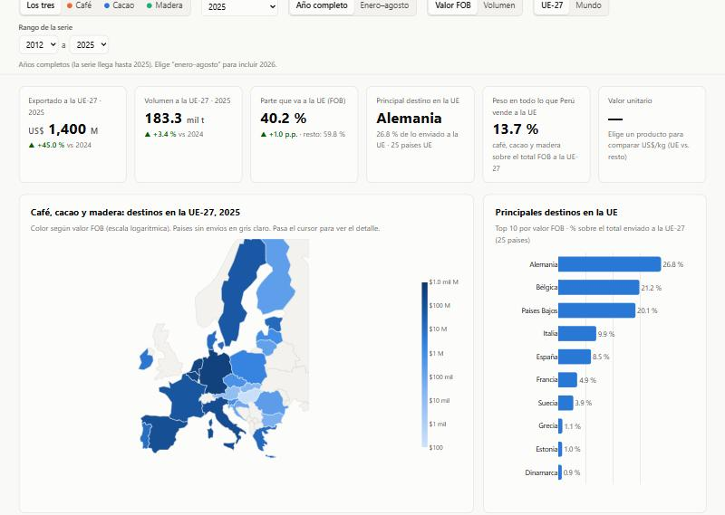
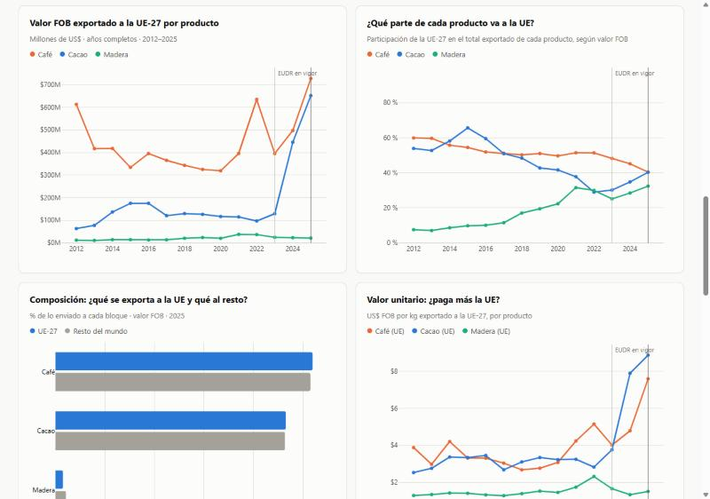

# Tarea 3 · Café, cacao y madera: ¿cuánto exporta el Perú a la Unión Europea bajo el reglamento antideforestación (EUDR)?

**Dashboard público:** <https://loryac21-cyber.github.io/tareas-python/tarea_3lac/web/>
**Publicación de LinkedIn:** _(pendiente)_



## 1. Tema y pregunta de investigación

El **Reglamento (UE) 2023/1115 (EUDR)** prohíbe vender en la Unión Europea café, cacao, madera y otros productos si provienen de tierras
deforestadas después del 31/12/2020. Cada envío necesitará una declaración de diligencia debida con la geolocalización de las parcelas.
Tras dos aplazamientos, se aplicará desde el **30 de diciembre de 2026** a operadores grandes y medianos, y desde el 30 de junio de 2027 a
micro y pequeñas empresas (Reglamento (UE) 2025/2650). El Perú está clasificado como país de **riesgo estándar** (Reglamento de Ejecución
(UE) 2025/1093).

> **Pregunta:** ¿cuál es el valor FOB y el volumen de las exportaciones peruanas de café, cacao y madera hacia la Unión Europea, a qué países
> llegan y qué tan dependiente es cada producto de ese mercado ahora que entra en aplicación el EUDR?

**Cobertura:** Perú → 27 países de la UE (y el resto del mundo como comparación), enero 2005 a agosto 2026, datos mensuales.

## 2. Descripción del proyecto

1. Se descargan los cuadros oficiales de exportación de SUNAT y se extraen las subpartidas de café, cacao y madera.
2. Se limpian y normalizan los países de destino (ISO-3, bloque UE-27) y se construyen indicadores: FOB, volumen, participación de la UE,
   valor unitario (US$/kg) y variaciones interanuales.
3. Se publica un **dashboard interactivo** (HTML + Plotly.js) con 6 KPIs, un mapa coroplético de destinos, 5 gráficos, una tabla
   descargable y 6 controles: producto, año, periodo, indicador (valor o volumen), ámbito del mapa (UE o mundo) y rango de años.

## 3. Fuentes de datos y metodología

| Fuente | Uso |
|---|---|
| [SUNAT · Nota Tributaria, Cuadro G8](https://www.sunat.gob.pe/estadisticasestudios/exportaciones.html): exportación definitiva por país de destino y subpartida nacional, mensual | Base principal |
| [SUNAT · Nota Tributaria, Cuadro G9](https://www.sunat.gob.pe/estadisticasestudios/exportaciones.html): exportación definitiva por subpartida, anual | Validación de totales |
| [Reglamento (UE) 2023/1115](https://eur-lex.europa.eu/eli/reg/2023/1115/oj), Anexo I | Lista de productos (códigos SA) |
| [Consejo de la UE (18/12/2025)](https://www.consilium.europa.eu/en/press/press-releases/2025/12/18/deforestation-council-signs-off-targeted-revision-to-simplify-and-postpone-the-regulation/) · [Reg. de Ejecución 2025/1093](https://eur-lex.europa.eu/eli/reg_impl/2025/1093/oj) | Fechas de aplicación y clasificación de riesgo |

Datos descargados el 31/10/2026.

**Metodología**

- **Alcance EUDR:** café (partida 0901), cacao y derivados (1801–1806) y madera (capítulo 44).
- **Validación:** la suma del G8 por subpartida coincide con el G9 en todos los años 2005–2025 (diferencia 0,0 %).
- **Fuente descartada:** se probó la consulta en línea de Aduanet ("Acumulado anual subpartida nacional/país"). Desde 2020 reporta solo una
  fracción del total oficial: en 2024, el 24 % del café y el 2 % del cacao en grano. Por eso se usa la Nota Tributaria (ver notebook 01).
- **UE-27:** se usa la composición actual en todos los años. Los departamentos franceses de ultramar se suman a Francia. El Reino Unido
  queda fuera.
- **Indicadores:** valor unitario = FOB / peso neto. Las variaciones comparan el mismo periodo del año anterior. 2026 se compara en
  enero–agosto.

## 4. Tres hallazgos principales

1. **La UE compra el 40 % del café y el 40 % del cacao peruano.** En 2025, el Perú envió a la UE-27 **US$ 1 400 millones** en productos
   EUDR: café (US$ 728 millones), cacao (US$ 652 millones) y madera (US$ 21 millones). Estos productos ya son el **13,7 %** de todo lo que
   el Perú vende a la UE (7,9 % en 2023).
2. **El cacao vendido a la UE se multiplicó por 5 en dos años, sobre todo por precio.** Pasó de US$ 129 millones (2023) a US$ 652 millones
   (2025), mientras el volumen solo se multiplicó por 2,1 (34,2 → 73,5 mil t). El valor unitario subió de 3,77 a 8,87 US$/kg. El **77 %**
   de lo que va a la UE es cacao en grano (48 % en el resto del mundo), la materia prima que el EUDR exige rastrear hasta la parcela. En
   enero–agosto de 2026, el valor enviado a la UE cayó 56 % y el volumen 15 %.
3. **El café se aleja de Europa.** La UE pasó de comprar el 54 % (2015) al 40 % (2025) del café peruano. Entre 2019 y 2025, el volumen
   enviado a la UE cayó 18 % (117,3 → 95,9 mil t), mientras el total exportado subió 4 %. Estados Unidos es el primer comprador (33 %).
   Dentro de la UE, Alemania y Bélgica reciben el 67 %. El cambio coincide con la llegada del EUDR, pero no se le puede atribuir solo a él.



Gráficos del análisis (notebook 03): [FOB a la UE por producto](figuras/01_fob_ue_por_producto.png) ·
[participación UE](figuras/02_participacion_ue.png) · [cacao: valor vs volumen](figuras/03_cacao_valor_vs_volumen.png) ·
[destinos UE](figuras/04_destinos_ue.png).

## 5. Limitaciones

- **Destino declarado ≠ consumo final.** Bélgica y Países Bajos son puertos de entrada (Amberes, Róterdam). Parte de lo que llega se reexporta.
- **Alcance parcial del EUDR.** No se incluyen pulpa y papel (cap. 47–49) ni muebles de madera (9401/9403).
- **Año parcial.** 2026 solo tiene enero–agosto.
- **Comercio no es deforestación.** Los datos no permiten saber qué envíos cumplirían el EUDR ni de qué parcelas provienen.
- **Causalidad.** Las variaciones también responden a precios internacionales (máximos históricos del cacao en 2024), al clima y a la demanda.

## 6. Enlaces

- Dashboard: <https://loryac21-cyber.github.io/tareas-python/tarea_3lac/web/>
- LinkedIn: _(pendiente)_

## 7. Cómo reproducir

Se necesita [uv](https://docs.astral.sh/uv/) (Python 3.14):

```bash
cd tarea_3lac
uv sync                       # crea .venv con las dependencias (o: pip install -r requirements.txt)
```

Luego se ejecutan los notebooks en orden, con el kernel `.venv` (en VS Code: *Select Kernel → eudr-exportaciones-peru*):

| Notebook | Qué hace | Salidas |
|---|---|---|
| `01_obtener_datos.ipynb` | Descarga los cuadros G8 y G9 de SUNAT, extrae las subpartidas EUDR y valida | `datos/originales/extracto_*.csv` |
| `02_procesar_datos.ipynb` | Limpieza, países ISO-3, UE-27, subgrupos, indicadores | `datos/procesados/*.csv`, `web/data/datos.json` |
| `03_analisis.ipynb` | Cifras de los hallazgos y gráficos | `figuras/*.png`, `web/data/hallazgos.json` |

El Cuadro G8 pesa 175 MB, así que no se sube al repositorio (`.gitignore`). El notebook 01 lo descarga de nuevo. Para ver el dashboard en
local:

```bash
uv run python -m http.server 8000
```

y abrir <http://localhost:8000/web/>.

**Publicación (GitHub Pages):** en el repositorio `tareas-python` → *Settings → Pages → Deploy from a branch → `main` / `(root)`*. El
dashboard queda en `https://loryac21-cyber.github.io/tareas-python/tarea_3lac/web/`.

### Estructura

```
tarea_3lac/
├── 01_obtener_datos.ipynb
├── 02_procesar_datos.ipynb
├── 03_analisis.ipynb
├── datos/
│   ├── originales/      # extractos SUNAT (G9 completo; G8 se descarga) + metadatos de descarga
│   └── procesados/      # tabla mensual limpia, indicadores, países
├── figuras/             # gráficos del análisis y capturas del dashboard
├── web/                 # dashboard (index.html, assets/, data/)
├── pyproject.toml · uv.lock · requirements.txt
└── README.md
```

## 8. Uso de inteligencia artificial

Usé **Claude Code** (Anthropic) para buscar las fuentes, escribir el código de descarga, limpieza y análisis, y construir el dashboard. Revisé
y validé los datos: los totales del G8 se contrastaron con el G9, y las cifras de los hallazgos se calculan en el notebook 03 y se leen
directamente desde el dashboard.
